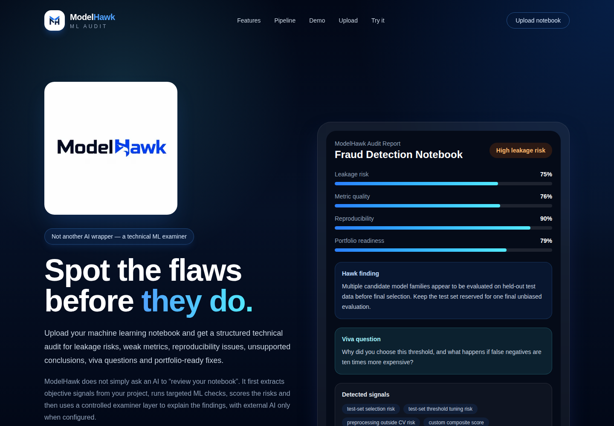
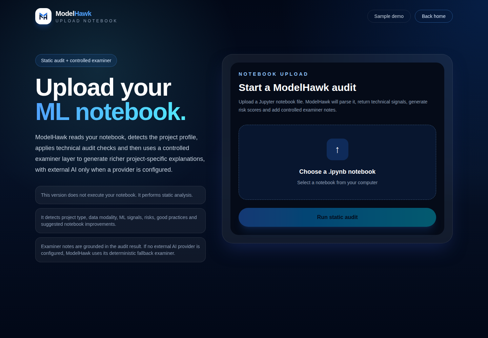
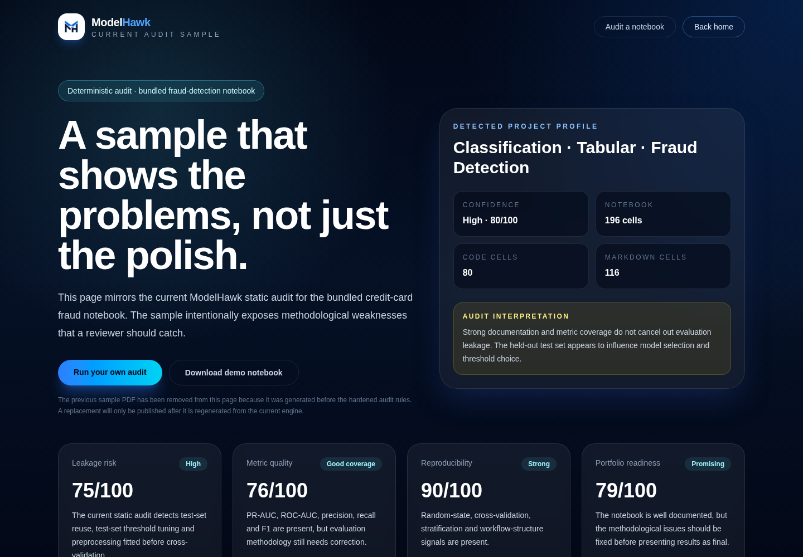

<p align="center">
  
</p>

<h1 align="center">ModelHawk</h1>

<p align="center">
  Static technical auditing for machine-learning notebooks.
</p>

<p align="center">
  <a href="https://modelhawk.onrender.com"><strong>Live demo</strong></a>
  ·
  <a href="https://modelhawk.onrender.com/demo">Current sample audit</a>
  ·
  <a href="https://modelhawk.onrender.com/upload">Audit a notebook</a>
</p>

<p align="center">
  <a href="https://github.com/albertoreyescastro/ModelHawk/actions/workflows/ci.yml">
    
  </a>
  
  
  
  
</p>

---

## What ModelHawk is

ModelHawk is a portfolio-grade prototype for reviewing Jupyter notebooks before they are submitted, defended or shown to technical reviewers.

It does **not** execute notebook code. Instead, it parses `.ipynb` content, extracts workflow evidence and applies deterministic checks for issues such as:

- test-set reuse during model or strategy selection
- threshold tuning against held-out test labels
- preprocessing fitted before cross-validation
- resampling order and leakage risk
- weak or inappropriate evaluation metrics
- missing reproducibility controls
- unsupported model-selection scores
- insufficient limitations, business context or technical explanation

The result is a structured audit with risk scores, findings, remediation priorities and viva/interview questions. An optional examiner layer can turn the structured audit into clearer narrative guidance, but the deterministic audit remains the source of evidence.

---

## Live deployment

**Production URL:** https://modelhawk.onrender.com

Useful routes:

- `/` — product overview
- `/demo` — sample audit aligned with the current hardened rules
- `/upload` — notebook upload workflow
- `/api/health` — deployment health and revision endpoint

The public instance currently runs on Render's free web-service tier. It can spin down after inactivity, so the first request after an idle period may briefly show Render's loading screen while the service wakes. The application itself is containerised and the same Docker image is exercised in CI before merge. Render is configured to deploy from `main` only after the GitHub checks pass.

The public deployment does not require a hosted AI-provider key. If no external provider is configured, the examiner layer uses the deterministic fallback path.

---

## Current sample audit

The bundled credit-card fraud notebook is intentionally useful as a regression fixture because it contains both strong project documentation and methodological problems that a reviewer should catch.

The current hardened audit reports:

| Dimension | Score |
| --- | ---: |
| Leakage risk | **75 / 100** |
| Metric quality | **76 / 100** |
| Reproducibility | **90 / 100** |
| Portfolio readiness | **79 / 100** |

Current high-severity findings include:

1. **Possible test-set reuse for model or strategy selection**
2. **Threshold exploration appears to use the test set**
3. **Preprocessing appears to be fitted before cross-validation**

The audit also flags a medium-severity concern around a custom weighted model-selection score.

These values are taken from the current deterministic `/api/audit` output for the bundled notebook rather than from an older static report.

The obsolete static sample PDF has been retired. Current PDF output is generated on demand from the current audit result through `/api/report/pdf`.

---

## Audit pipeline

```text
.ipynb upload
    |
    v
Notebook parser
    |
    v
Workflow and evidence extraction
    |
    v
Deterministic ML audit rules
    |
    +--> risk scores
    +--> findings
    +--> good-practice signals
    +--> remediation priorities
    +--> viva questions
    |
    v
Optional examiner layer
    |
    v
Web report / LaTeX PDF route
```

The design deliberately keeps evidence extraction and deterministic checks separate from explanatory AI output.

---

## Hardening and safety controls

The current implementation includes:

- notebook/request size limits
- input and notebook-shape validation
- bounded AI-provider request sizes
- AI request concurrency limits
- provider timeouts
- API keys sent in headers rather than URLs
- deterministic fallback behaviour when providers are unavailable
- bounded PDF-generation concurrency
- `pdflatex` timeout handling
- `pdflatex -no-shell-escape`
- process spawning without a shell
- temporary-file cleanup
- production security headers
- non-root Docker runtime
- deployment health checks

ModelHawk is still a static-review prototype. It should be treated as technical guidance, not as proof that a model or notebook is correct.

---

## Regression coverage

The audit regression suite covers cases including:

- SMOTE imported before a split without falsely calling it leakage
- actual resampling before a split
- `predict_proba` without falsely calling it threshold tuning
- explicit threshold selection
- one model family versus multiple distinct model families
- confidence calibration from weak evidence
- scaler fitting before a split
- test-set model ranking
- threshold grids scored on `y_test`
- validation threshold tuning without mislabelling it as test tuning
- preprocessing outside cross-validation
- custom weighted composite scores

Run locally with:

```bash
npm test
```

---

## CI and production container

Every pull request runs two gates.

### Quality gate

```text
npm ci
npm test
npm run typecheck
npm run lint
npm run build
npm audit --omit=dev --audit-level=high
```

### Production container E2E

CI then:

1. builds the real Docker image
2. starts the production container
3. waits for `/api/health`
4. verifies the LaTeX runtime inside the image
5. submits the bundled fraud notebook to `/api/audit`
6. asserts the deterministic regression scores and findings
7. posts that audit result to `/api/report/pdf`
8. validates that the response is a complete PDF document
9. tears the container down

This catches both application regressions and runtime packaging failures. The PDF path is therefore exercised through the same HTTP boundary used by the deployed service rather than being reduced to a `pdflatex --version` check.

Third-party GitHub Actions are pinned to immutable commit SHAs rather than floating tags.

---

## Local development

Requirements:

- Node.js 24.x (`.nvmrc`)
- npm
- Docker, if you want to reproduce the production container
- `pdflatex` only if running the PDF route outside Docker

Install and start:

```bash
npm ci
npm run dev
```

Then open:

```text
http://localhost:3000
```

Optional provider configuration is documented in `.env.example`.

---

## Docker

Build and run the production image:

```bash
docker build -t modelhawk .
docker run --rm -p 3000:3000 modelhawk
```

Health check:

```bash
curl http://localhost:3000/api/health
```

---

## Screenshots

All three screenshots below were captured from the current public deployment at a 1440 × 1000 desktop viewport.

### Landing page



### Notebook upload workflow



### Live sample audit



---

## Scope and limitations

ModelHawk currently performs **static** notebook analysis. It does not execute cells, reproduce training runs or independently validate reported metrics.

A static finding can be strong evidence of a workflow risk, but absence of a finding is not proof of correctness. The intended use is to surface review questions early and make notebook methodology easier to defend.

Future work can add bounded execution-based checks, stress tests and stronger evaluation provenance without weakening the deterministic review layer.

---

## Repository structure

```text
app/
  api/audit/        deterministic notebook audit
  api/audit/ai/     optional examiner layer
  api/health/       deployment health endpoint
  api/report/pdf/   LaTeX report generation
  demo/             current sample audit
  upload/           notebook upload workflow
lib/
  audit-heuristics.mjs
tests/
  audit-heuristics.test.mjs
public/
  examples/
Dockerfile
render.yaml
.github/workflows/ci.yml
.github/dependabot.yml
```

---

## Author

**Alberto Reyes Castro**

MSc Artificial Intelligence Technology · London, UK
